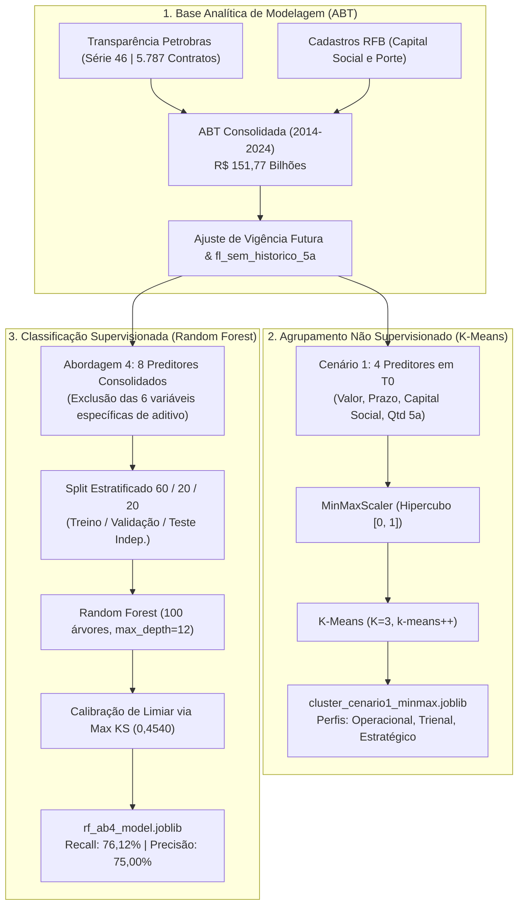

# Especificação Técnica do Projeto — Predição e Agrupamento Contratual (Petrobras — Geisiane)

**Versão:** `v3.0.0` (Alinhada ao Pacote de Machine Learning da Geisiane)  
**Instituição:** Universidade Federal de Goiás (UFG) — Instituto de Informática (INF)  
**Disciplina:** Aprendizado de Máquina — Prof. Dr. Ronaldo Martins da Costa  
**Escopo Metodológico:** Classificação Supervisionada (Random Forest Abordagem 4 com Calibração Max KS) e Clusterização Não Supervisionada (K-Means Cenário 1 com MinMaxScaler, $K=3$). Tarefa de regressão formalmente descontinuada.  

---

## 1. Visão Geral do Sistema

### 1.1 Objetivo e Contexto
No âmbito das contratações públicas regidas pela Lei das Estatais (Lei nº 13.303/2016) e pelo Marco Legal das Startups (LC 182), os termos aditivos de prazo e valor acarretam imprevisibilidade orçamentária e risco de descontinuidade operacional nas contratações da Petrobras (Série 46).

O sistema opera no momento da celebração contratual ($T_0$), apoiado em uma **arquitetura dual** desenvolvida e validada por Geisiane:
1. **Pilar 1 — Classificação Supervisionada (Random Forest Abordagem 4):** Estima a probabilidade de um contrato sofrer aditamento (`fl_aditivo` = 1 ou 0) a partir de 8 preditores pré-contratuais consolidados, operando sob o ponto de corte ótimo calibrado via **Kolmogorov-Smirnov ($KS = 0,4019$, limiar $0,4540$)**, garantindo equilíbrio superior entre Sensibilidade (Recall: 76,12%) e Precisão (75,00%) no teste independente.
2. **Pilar 2 — Clusterização Não Supervisionada (K-Means Cenário 1, MinMaxScaler, $K=3$):** Segmenta a carteira contratual em 3 arquétipos de governança a partir de 4 variáveis estritamente ex-ante em $T_0$, sem contaminação de variáveis de aditivo na definição geométrica dos grupos.



---

## 2. Engenharia de Dados e Governança de Preditores

Base de dados: `dados/abt_modelagem_aditivos.csv` (5.787 contratos finalizados da Série 46 da Petrobras).

### 2.1 Variável Alvo da Classificação (Target)
- **`fl_aditivo`**:
  - `1`: Contrato com ao menos um termo aditivo de prazo e/ou valor (3.398 contratos | 58,72% da base).
  - `0`: Contrato executado sem qualquer termo aditivo (2.389 contratos | 41,28% da base).

### 2.2 Tratamento Anti-Leakage e Padronização em $T_0$
- **Ajuste de Vigência Futura:** Para contratos cujo término teórico cadastral exceda a data de corte (`Fim_Vigencia > Data_Atual`), a vigência observada é truncada na data corrente, eliminando aberrações temporais.
- **Isolamento em $T_0$:** A experiência prévia do fornecedor é apurada exclusivamente na janela dinâmica de **5 anos retroativos** à celebração do contrato analisado (`Inicio_Vigencia`).
- **Indicador de Histórico:** Criação de `fl_sem_historico_5a = 1` para fornecedores sem contratos nos 5 anos anteriores, zerando taxas residuais imputadas.
- **Variáveis Vedadas (Anti-Leakage e LGPD):** `Saldo_Bruto`, `Saldo_Inativo`, contagens e valores de aditivos ocorridos na vigência, `Fornecedor`, `Razao_Social_Receita` e `CNPJ`/`CNPJ_Basico` (proteção de MEIs e prepostos).

### 2.3 Conjunto de Preditores da Classificação (Abordagem 4)
A Abordagem 4 elimina as 6 variáveis específicas fragmentadas (`tx_adit_prazo_5a`, `tx_adit_pv_5a`, `tx_adit_val_5a`, `qtd_adit_prazo_5a`, `qtd_adit_pv_5a`, `qtd_adit_val_5a`), mantendo **8 atributos preditores**:
* **Numéricos (6 atributos):**
  1. `Valor_Original`: Montante inicial pactuado em Reais (R$).
  2. `duracao_planejada_dias`: Prazo inicial acordado em dias corridos.
  3. `Capital_Social_Receita`: Capacidade patrimonial perante a Receita Federal (R$).
  4. `qtd_cont_5a_forn`: Quantidade de contratos celebrados nos 5 anos anteriores.
  5. `tx_adit_geral_5a`: Taxa geral histórica de contratos aditivados pelo fornecedor em 5 anos.
  6. `fl_sem_historico_5a`: Indicador binário (1 = novo fornecedor, 0 = com histórico prévio).
* **Categóricos (2 atributos):**
  1. `Porte_Empresa`: Porte societário registrado (DEMAIS, EPP, ME, Não Informado).
  2. `tipo_ult_adit`: Natureza do último aditivo (PRAZO, VALOR, PRAZO E VALOR, SEM HISTORICO).

---

## 3. Metodologia de Modelagem e Resultados Homologados

### 3.1 Pilar 1: Classificação Supervisionada (Random Forest Abordagem 4)
- **Particionamento Estratificado (random_state=42):**
  - **Treinamento (60%):** 3.471 contratos para ajuste dos pesos das árvores.
  - **Validação (20%):** 1.158 contratos para calibração fina do ponto de corte por Kolmogorov-Smirnov.
  - **Teste Independente (20%):** 1.158 contratos (holdout inédito) para comprovação científica cega.
- **Algoritmo:** Random Forest (`n_estimators=100`, `max_depth=12`, `class_weight='balanced'`).
- **Otimização de Limiar via Max KS:**
  - $KS = \max (TPR - FPR) = 0,4019$ alcançado no limiar ótimo de **$0,4540$**.
- **Resultados Homologados nas 3 Partições:**

| Partição | Amostras | Limiar KS | Max KS | Acurácia | ROC-AUC | F1-Score | Recall (Sensibilidade) | Precisão | Especificidade |
| :--- | :---: | :---: | :---: | :---: | :---: | :---: | :---: | :---: | :---: |
| **Treino (60%)** | 3.471 | 0,4540 | 0,4019 | 75,54% | 0,8371 | 0,7918 | 79,16% | 79,20% | 70,34% |
| **Validação (20%)** | 1.158 | 0,4540 | 0,4019 | 70,90% | 0,7587 | 0,7509 | 75,48% | 74,71% | 65,48% |
| **Teste Indep. (20%)** | 1.158 | 0,4540 | 0,4019 | **71,50%** | **0,7652** | **0,7556** | **76,12%** | **75,00%** | **66,53%** |

- **Matriz de Confusão no Teste Independente ($N = 1.158$):**
  - $VP = 517$ (Aditivos previstos com acerto)
  - $VN = 312$ (Não aditivados previstos com acerto)
  - $FP = 167$ (Falsos alarmes controlados)
  - $FN = 162$ (Contratos aditivados não antecipados)

---

### 3.2 Pilar 2: Clusterização Não Supervisionada (K-Means Cenário 1, MinMaxScaler)
- **Pré-processamento:** Normalização via `MinMaxScaler` no intervalo $[0, 1]$, equalizando grandezas financeiras (bilhões) com durações temporais (dias) e experiência prévia.
- **Preditores de Agrupamento em $T_0$ (4 variáveis puramente ex-ante):**
  `Valor_Original`, `duracao_planejada_dias`, `Capital_Social_Receita`, `qtd_cont_5a_forn`.
- **Métricas de Diagnóstico ($K=3$):**
  - Coeficiente de Silhueta: **$0,6082$**
  - Índice Davies-Bouldin: **$0,5223$** (quanto menor, melhor)
  - Calinski-Harabasz: **$9.753$**
- **Arquétipos e Segmentação da Carteira:**

| Cluster | Segmento Operacional | N Contratos | Proporção | Mediana Valor | Duração Média | Taxa Observada Aditivos | Diretriz de Governança |
| :---: | :--- | :---: | :---: | :---: | :---: | :---: | :--- |
| **Cluster 1** | **Operacional / Menor Complexidade** | 1.667 | 28,8% | R$ 2,07 mi | 562 dias (~1,5 ano) | **44,2%** | Contratos pontuais e curtos; menor exposição; gestão de rotina simplificada. |
| **Cluster 3 (0)** | **Intermediário / Trienal Padrão** | 2.739 | 47,3% | R$ 2,85 mi | 1.101 dias (~3,0 anos) | **54,9%** | Maior contingente da carteira; prestação contínua; monitoramento preventivo a partir do 24º mês. |
| **Cluster 2** | **Estratégico / Alta Complexidade** | 1.381 | 23,9% | R$ 7,70 mi | 1.641 dias (~4,5 anos) | **83,9%** | Megaprojetos e grandes concessões; altíssima criticidade; comitê gestor de mudanças mandatório. |

---

## 4. Arquitetura de Software e Endpoints Integrados

```
┌────────────────────────────────────────────────────────┐
│                   Frontend (React + Vite)              │
│  - Simulador com 8 Preditores da Abordagem 4           │
│  - Risk Gauge calibrado com Limiar KS (0,4540)         │
│  - Diagnóstico do Cluster K-Means (MinMaxScaler, K=3)  │
│  - Matrizes de Confusão e Curvas Diagnósticas          │
└───────────────────────────▲────────────────────────────┘
                            │ HTTP / JSON (REST)
┌───────────────────────────▼────────────────────────────┐
│                  Backend (FastAPI)                     │
│  - POST /api/predict (Inferência Random Forest Ab4)    │
│  - POST /api/predict-cluster (Inferência K-Means C1)   │
│  - GET  /api/metrics (Métricas das 3 Partições e KS)   │
│  - GET  /api/cluster-report (Perfis e Percentis)       │
│  - GET  /api/feature-importance                        │
└───────────────────────────▲────────────────────────────┘
                            │ Carregamento de Artefatos .joblib
┌───────────────────────────▼────────────────────────────┐
│              Artefatos do Pacote Geisiane              │
│  - rf_ab4_model.joblib (Pipeline RF Abordagem 4)       │
│  - cluster_cenario1_minmax.joblib (K-Means MinMaxScaler)│
└────────────────────────────────────────────────────────┘
```

### Endpoints RESTful Homologados:
1. `POST /api/predict` — Inferência probabilística com limiar KS (0,4540) e categorização de risco.
2. `POST /api/predict-cluster` — Classificação do contrato em um dos 3 clusters de governança.
3. `GET /api/metrics` — Métricas acadêmicas completas das 3 partições (Treino, Validação e Teste).
4. `GET /api/cluster-report` — Estatísticas percentílicas e diretrizes de governança dos 3 clusters.
5. `GET /api/feature-importance` — Importância das variáveis (Gini e Permutação).
6. `GET /api/contract-options` — Metadados e limites dos 8 preditores para validação na UI.
7. `GET /health` — Monitoramento de integridade e versão dos pipelines.

*(Endpoint de regressão `/api/predict-value` expressamente descontinuado).*

