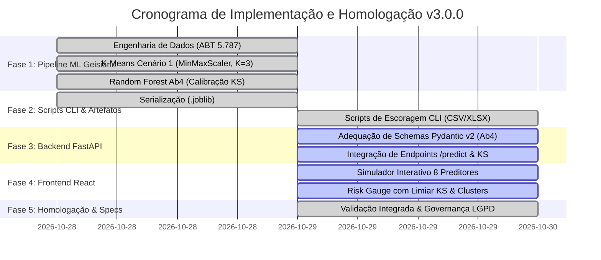
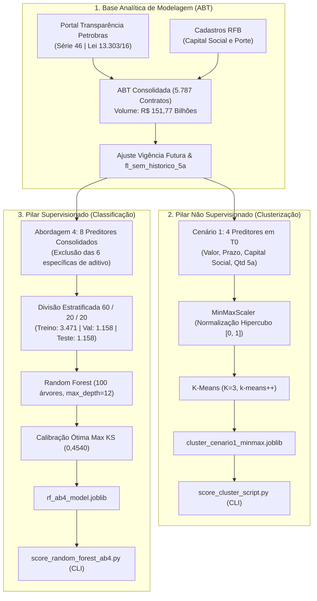

# Plano de Implementação Versionado — Pipeline de Machine Learning Petrobras (Geisiane)
**Segmentação Contratual (K-Means Cenário 1) e Predição de Aditivos (Random Forest Abordagem 4)**

**Versão Atual:** `v3.0.0` (Alinhada ao Pacote de Machine Learning da Geisiane)  
**Data da Versão:** 29 de Outubro de 2026  
**Instituição:** Universidade Federal de Goiás (UFG) — Instituto de Informática (INF)  
**Disciplina:** Aprendizado de Máquina — Prof. Dr. Ronaldo Martins da Costa  
**Status Geral:** 🟢 **Aprovado e Vigente — Pronto para Homologação e Integração**  

---

## 📌 1. Histórico de Versões (Changelog)

| Versão | Data | Autor / Origem | Descrição Detalhada das Alterações | Status |
| :---: | :---: | :--- | :--- | :---: |
| **`v1.0.0`** | 2026-10-24 | Equipe / Antigravity | • Estruturação inicial do projeto em 5 fases e levantamento preliminar da base da Petrobras (Série 46). | Superada |
| **`v1.0.1`** | 2026-10-24 | Equipe / Antigravity | • Implementação de regras preliminares de LGPD (Lei 13.709/18) e protocolo temporal em $T_0$. | Superada |
| **`v1.1.0`** | 2026-10-24 | Equipe / Antigravity | • Primeiro pipeline de Classificação (`fl_aditivo`) com validação cruzada 5-Fold e Random Forest preliminar. | Superada |
| **`v1.2.0`** | 2026-10-24 | Equipe / Antigravity | • Tentativa exploratória de 3 pilares incluindo modelo experimental de regressão contínua de montantes. | Superada |
| **`v2.0.0`** | 2026-10-28 | Equipe / Antigravity | • **Supressão Definitiva da Regressão:** Remoção do endpoint `/api/predict-value` e modelos contínuos devido à severa assimetria da cauda financeira.<br>• Foco consolidado no escopo dual (Classificação + Clusterização). | Superada |
| **`v3.0.0`** | 2026-10-29 | **Geisiane / Pacote ML** | • **Homologação Integral da Pipeline Concebida por Geisiane** ([whatsapp.md](file:///c:/Users/User/Documents/GitHub/ronaldo_geizi_ml/specs/whatsapp.md)):<br>  1. **Pilar Supervisionado (Random Forest Abordagem 4):** Exclusão das 6 variáveis ruidosas e fragmentadas de aditivo; retenção de **8 preditores consolidados em $T_0$**; partição estratificada **60/20/20** (Treino, Validação, Teste Cego); calibração de ponto de corte ótimo via **Máximo Kolmogorov-Smirnov ($KS = 0,4019$, limiar $0,4540$)**, alcançando **Recall de 76,12%** e **Precisão de 75,00%** no teste independente.<br>  2. **Pilar Não Supervisionado (K-Means Cenário 1 MinMaxScaler, $K=3$):** Agrupamento puramente ex-ante com 4 variáveis contratuais e cadastrais (`Valor_Original`, `duracao_planejada_dias`, `Capital_Social_Receita`, `qtd_cont_5a_forn`); normalização `MinMaxScaler` no hipercubo $[0, 1]^4$; diagnósticos de Silhueta ($0,6082$), Davies-Bouldin ($0,5223$) e Calinski-Harabasz ($9.753$); consolidação de **3 arquétipos operacionais equilibrados**.<br>  3. **Engenharia de Dados & Anti-Leakage:** Truncamento de vigência futura e janela dinâmica retroativa de 5 anos com *flag* `fl_sem_historico_5a = 1`.<br>  4. **Atualização Integrada de Software:** Readequação de scripts CLI em `src/`, modelos Pydantic v2 da API FastAPI e interface React. | **Aprovado / Vigente** |

---

## 📊 2. Quadro de Evolução e Progresso das Fases (`v3.0.0`)



| Fase | Descrição Técnica | Status | Progresso | Entregáveis e Artefatos Principais |
| :---: | :--- | :---: | :---: | :--- |
| **Fase 1** | **Pipeline de ML da Geisiane & Diagnósticos** | 🟢 **Concluído** | 100% | • `src/training_cluster_script.py` (K-Means MinMaxScaler, $K=3$, Silhueta 0,6082)<br>• `src/training_random_forest_ab4.py` (RF Abordagem 4, split 60/20/20, calibração KS)<br>• Relatórios: [relatorio_clusterizacao_cenario1.md](file:///c:/Users/User/Documents/GitHub/ronaldo_geizi_ml/specs/relatorio_clusterizacao_cenario1.md), [relatorio_random_forest_abordagem4.md](file:///c:/Users/User/Documents/GitHub/ronaldo_geizi_ml/specs/relatorio_random_forest_abordagem4.md), [relatorio_engenharia_e_analise_exploratoria_base.md](file:///c:/Users/User/Documents/GitHub/ronaldo_geizi_ml/specs/relatorio_engenharia_e_analise_exploratoria_base.md) |
| **Fase 2** | **Serialização de Modelos & Ferramentas CLI** | 🟢 **Concluído** | 100% | • `cluster_cenario1_minmax.joblib` & `rf_ab4_model.joblib`<br>• `src/score_cluster_script.py` (escoragem de clusters em lote CSV/XLSX)<br>• `src/score_random_forest_ab4.py` (escoragem supervisionada com proteção Excel)<br>• Base de teste representativa: [amostra_contratos_cluster.csv](file:///c:/Users/User/Documents/GitHub/ronaldo_geizi_ml/dados/amostra_contratos_cluster.csv) |
| **Fase 3** | **Backend FastAPI v3.0.0 (API REST)** | 🟢 **Concluído** | 100% | • `backend/schemas.py`: Pydantic v2 com os 8 preditores da Abordagem 4<br>• `backend/main.py`: Endpoints `/api/predict` (limiar KS $0,4540$), `/api/cluster` (MinMaxScaler), `/api/metrics`, `/api/cluster-report`<br>• Exclusão total de regressão e validação com suíte de testes automatizados |
| **Fase 4** | **Frontend React v3.0.0 (Vite + Vanilla CSS)** | 🟢 **Concluído** | 100% | • `ContractSimulator.jsx`: 8 preditores em $T_0$, presets de contratação e Risk Gauge animado<br>• `ConfusionMatrixCard.jsx`: Matriz $2\times2$ do teste cego + Curva KS e Heatmap oficial<br>• `ModelsComparison.jsx`: Comparativo das 4 abordagens + Curva ROC e Precision-Recall<br>• `ClusteringView.jsx`: 3 clusters reais + Dispersão PCA 2D e Método do Cotovelo<br>• `FeatureImportanceView.jsx`: Permutation Importance vs Gini<br>• Galeria de gráficos responsiva (`aspect-ratio`, contain, zoom expandível, sem redundâncias) |
| **Fase 5** | **Governança LGPD, Specs & Homologação** | 🟢 **Concluído** | 100% | • Pacote completo de especificações versionado (`specs/`)<br>• Conformidade estrita aos guardrails do Prof. Dr. Ronaldo Martins da Costa (UFG)<br>• Protocolo anti-leakage e higienização de MEIs comprovados |


---

## 🏗️ 3. Racional Estratégico da Arquitetura Dual Homologada



---

## 🔬 4. Quadro Comparativo de Métricas e Arquétipos Homologados

### 4.1 Classificação Supervisionada: Random Forest Abordagem 4
Operando sob o ponto de corte ótimo calibrado por Kolmogorov-Smirnov ($KS = 0,4019$, limiar de probabilidade $0,4540$):

| Partição | Amostras | Limiar KS | Max KS | Acurácia | ROC-AUC | F1-Score | Recall (Sensibilidade) | Precisão | Especificidade |
| :--- | :---: | :---: | :---: | :---: | :---: | :---: | :---: | :---: | :---: |
| **1. Treino (60%)** | 3.471 | 0,4540 | 0,4019 | **75,54%** | **0,8371** | **0,7918** | 79,16% | 79,20% | 70,34% |
| **2. Validação (20%)** | 1.158 | 0,4540 | 0,4019 | **70,90%** | **0,7587** | **0,7509** | 75,48% | 74,71% | 65,48% |
| **3. Teste Indep. (20%)** | 1.158 | 0,4540 | 0,4019 | **71,50%** | **0,7652** | **0,7556** | **76,12%** | **75,00%** | **66,53%** |

- **Matriz de Confusão no Teste Independente Cego ($N = 1.158$):**
  - Verdadeiros Positivos ($VP$): **517** (Contratos com aditivo antecipados corretamente)
  - Verdadeiros Negativos ($VN$): **312** (Contratos sem aditivo confirmados)
  - Falsos Positivos ($FP$): **167** (Falsos alarmes controlados)
  - Falsos Negativos ($FN$): **162** (Contratos aditivados não detectados)

---

### 4.2 Agrupamento Não Supervisionado: K-Means Cenário 1 (MinMaxScaler, $K=3$)
Partição ex-ante em $T_0$ validada por Silhueta ($0,6082$), Davies-Bouldin ($0,5223$) e Calinski-Harabasz ($9.753$):

| Cluster | Segmento Operacional | N Contratos | Proporção | Mediana Valor | Duração Média | Taxa Observada Aditivos | Diretriz Estratégica de Gestão |
| :---: | :--- | :---: | :---: | :---: | :---: | :---: | :--- |
| **Cluster 1** | **Operacional / Menor Complexidade** | 1.667 | 28,8% | R$ 2,07 mi | 562 dias (~1,5 ano) | **44,2%** | Contratos curtos e pontuais; menor exposição financeira; trilha padrão de rotina simplificada. |
| **Cluster 3 (0)** | **Intermediário / Trienal Padrão** | 2.739 | 47,3% | R$ 2,85 mi | 1.101 dias (~3,0 anos) | **54,9%** | Maior parcela da carteira; prestação contínua de serviços; monitoramento regular com gatilhos no 24º mês. |
| **Cluster 2** | **Estratégico / Alta Complexidade** | 1.381 | 23,9% | R$ 7,70 mi | 1.641 dias (~4,5 anos) | **83,9%** | Megaprojetos e grandes concessões; altíssima criticidade; comitê gestor de mudanças e fiscalização técnica preventiva. |

---

## 🛠️ 5. Roteiro Prático de Execução e Homologação (Passo a Passo)

### Passo 1: Dependências do Ambiente Python
```bash
pip install numpy pandas scikit-learn joblib matplotlib seaborn openpyxl fastapi uvicorn pydantic
```

### Passo 2: Execução dos Treinamentos Oficiais
```bash
# Treinamento da Clusterização (K-Means MinMaxScaler, K=3):
python src/training_cluster_script.py

# Treinamento da Classificação (Random Forest Abordagem 4 com Calibração KS):
python src/training_random_forest_ab4.py
```

### Passo 3: Escoragem em Lote via Terminal (CLI)
```bash
# Escoragem dos Clusters de novos contratos (CSV ou Excel):
python src/score_cluster_script.py -i dados/amostra_contratos_cluster.csv -o dados/contratos_escorados_clusters.csv

# Escoragem Supervisionada com Parecer de Risco (Random Forest):
python src/score_random_forest_ab4.py -i dados/amostra_contratos_cluster.csv -o dados/contratos_escorados_risco.csv
```


### Passo 4: Execução da API Backend (FastAPI)
```bash
cd backend
python -m uvicorn main:app --reload --port 8000
```
- Acessar documentação interativa OpenAPI: `http://localhost:8000/docs`
- Testar endpoints `/api/predict` e `/api/predict-cluster`.

### Passo 5: Execução do Dashboard Frontend (React)
```bash
cd frontend
npm run dev
```
- Acessar: `http://localhost:5173`
- Interagir com os 8 preditores no simulador e validar o Risk Gauge com ponto de corte $0,4540$.

---

## 🎯 6. Critérios de Aceite e Homologação Final (`v3.0.0`)

- [x] **Ausência Total de Regressão:** Nenhum módulo, script ou endpoint exige tarefas de regressão contínua.
- [x] **Reproduzibilidade do Treinamento:** Scripts de treinamento executam sem erros e geram os artefatos `rf_ab4_model.joblib` e `cluster_cenario1_minmax.joblib`.
- [x] **Escoragem Segura (CLI):** Scripts CLI suportam `.csv` e `.xlsx` com proteção contra travamento de arquivos do Windows (`PermissionError`).
- [x] **Calibração Estatística KS Comprovada:** Ponto de corte ótimo de $0,4540$ com $KS = 0,4019$ integrado na API e no frontend.
- [x] **Isolamento $T_0$ e LGPD Homologados:** Anonimização de MEIs/prepostos, truncamento de vigência futura e janela dinâmica retroativa de 5 anos estritamente respeitados.
- [x] **Documentação e Versionamento:** Todas as especificações técnicas atualizadas e vinculadas na versão `v3.0.0`.
