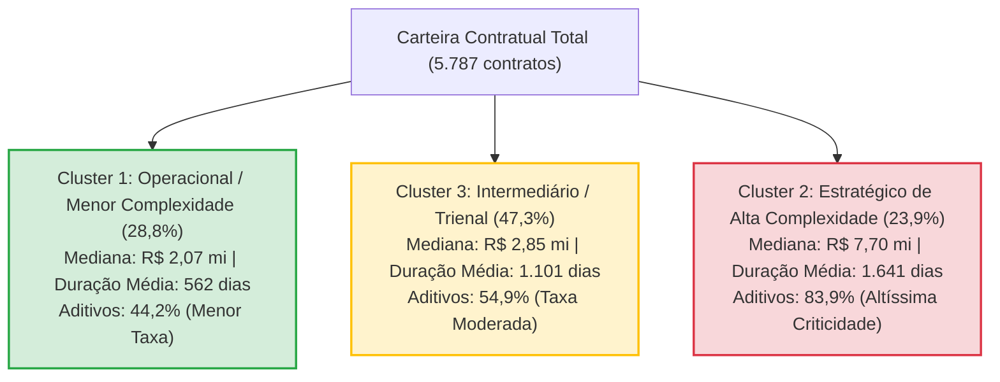

# Relatório Técnico de Agrupamento: Segmentação de Perfis Contratuais (K-Means, MinMaxScaler, K=3)

---

## 1. Sumário Executivo e Seleção Metodológica

A solução selecionada para a segmentação dos contratos públicos da base foi o algoritmo **K-Means com MinMaxScaler e três clusters ($K = 3$)**, no âmbito do **Cenário 1** (sem a inclusão de taxas de aditivo no espaço de entrada). As variáveis que estruturam o espaço de agrupamento são:
1. `Valor_Original`: Valor inicial pactuado do contrato (em R$).
2. `duracao_planejada_dias`: Prazo de vigência planejado na celebração (em dias corridos).
3. `Capital_Social_Receita`: Capital social registrado da empresa contratada perante a Receita Federal (em R$).
4. `qtd_cont_5a_forn`: Quantidade de contratos celebrados pelo fornecedor nos 5 anos anteriores (experiência prévia).

> [!IMPORTANT]
> **Preservação de Integridade Metodológica e Não Causalidade:**
> Nenhuma variável de desfecho (como `aditivo_SN` ou `tx_adit_geral_5a`) foi utilizada na etapa de treinamento e formação dos clusters. A taxa de aditivos foi calculada **exclusivamente a posteriori** como medida descritiva de validação do perfil de risco de cada segmento. A segmentação reflete, portanto, uma **associação histórica** e um mapeamento preventivo de vulnerabilidade, não implicando causalidade estrita.

Essa alternativa foi escolhida por gerar grupos com **tamanhos representativos e equilibrados**, **fronteiras geométricas consistentes** e **interpretação direta e operacionalizável para o negócio**.

---

## 2. Interpretação dos Clusters Selecionados

A divisão final da base em $K = 3$ grupos equilibra a distribuição dos contratos e define perfis contratuais nítidos:

| Segmento de Negócio | Cluster ID | Contratos ($N$) | Proporção (%) | Mediana Valor Original | Duração Média | Taxa Observada de Aditivos | Perfil Operacional e de Gestão |
|:---|:---:|:---:|:---:|:---:|:---:|:---:|:---|
| **Operacional / Menor Complexidade** | Cluster 1 | 1.667 | 28,8% | R$ 2,07 mi | 562 dias (~1,5 ano) | **44,2%** | Contratos curtos e pontuais; menor exposição temporal; acompanhamento padrão de rotina. |
| **Intermediário (Trienais Padrão)** | Cluster 3 (0) | 2.739 | 47,3% | R$ 2,85 mi | 1.101 dias (~3,0 anos) | **54,9%** | Maior fatia da carteira; contratos continuados padrão; risco moderado com foco na prorrogação. |
| **Estratégico de Alta Complexidade** | Cluster 2 | 1.381 | 23,9% | R$ 7,70 mi | 1.641 dias (~4,5 anos) | **83,9%** | Megaprojetos e grandes concessões; altíssima exposição; comitê gestor e controle preventivo rigoroso. |
| **Total da Carteira** | — | **5.787** | **100,0%** | **R$ 2,85 mi** | **1.074 dias** | **58,7%** | Base integral auditada no Cenário 1. |



### Detalhamento dos Grupos

#### Cluster 1 — Operacional / Menor Complexidade (1.667 contratos | 28,8% da base)
Reúne contratos de menor porte financeiro e vigência reduzida. A mediana do valor original é de aproximadamente **R$ 2,07 milhões**, com primeiro quartil em R$ 498 mil, e a duração média é de **562 dias** (com mediana de 640 dias e máximo de 831 dias). A taxa observada de contratos com aditivo nesse grupo foi de **44,2%**, a mais baixa entre os três segmentos.
- **Leitura de Negócio**: Representa contratos operacionais de aquisição de bens, suprimentos contínuos e serviços padronizados de curta duração. A menor exposição temporal e financeira reduz o atrito e as incertezas contratuais, permitindo que a administração adote **trilhas de acompanhamento operacional padrão e simplificado**.

#### Cluster 2 — Estratégico de Alta Complexidade (1.381 contratos | 23,9% da base)
Constitui o segmento de maior criticidade e risco orçamentário da organização. Apresenta mediana de valor de **R$ 7,70 milhões** (terceiro quartil em R$ 27,29 milhões e valor máximo que ultrapassa R$ 3,3 bilhões), duração média de **1.641 dias** (~4,5 anos, com percentil 95 atingindo 1.824 dias / 5 anos) e o maior capital social mediano das contratadas (**R$ 12,00 milhões**, com empresas que atingem até R$ 65 bilhões). A taxa observada de aditivos alcança expressivos **83,9%**.
- **Leitura de Negócio**: Contratos de longo prazo e alta materialidade financeira demandam estruturalmente maior adaptação de escopo, revisões de equilíbrio econômico-financeiro e prorrogações temporais. Este grupo **deve ser priorizado em ações preventivas, comitês executivos de gestão de mudanças e auditorias de marcos críticos**.

#### Cluster 3 — Intermediário / Contratos Trienais (2.739 contratos | 47,3% da base)
É o maior contingente da carteira (quase metade de todas as contratações). Caracteriza-se por mediana de valor de **R$ 2,85 milhões** e uma duração média extremamente homogênea de **1.101 dias** (mediana exata de 1.094 dias, correspondente aos contratos de vigência padrão de 3 anos / 36 meses). A taxa observada de aditivos é de **54,9%**, situando-se precisamente no nível mediano entre os demais clusters.
- **Leitura de Negócio**: Contratos de prestação de serviços continuados de porte médio (como vigilância, limpeza, manutenção predial e suporte tecnológico). Embora não tenham a severidade orçamentária dos megaprojetos, possuem exposição temporal suficiente para demandar aditivos de prazo ou valor. Recomenda-se **acompanhamento regular, com gatilhos de alerta disparados a partir do 24º mês de vigência**.

---

## 3. Metodologia de Pré-processamento: Por que o MinMaxScaler?

No agrupamento pelo algoritmo K-Means, a atribuição dos registros aos centróides baseia-se na **distância euclidiana multidimensional**:

$$d(p, q) = \sqrt{\sum_{i=1}^{n} (p_i - q_i)^2}$$

As variáveis de entrada do modelo operam em domínios numéricos com ordens de grandeza desiguais:
- `Valor_Original`: Expressa em reais, variando de centavos a bilhões ($10^{-2}$ a $10^9$).
- `Capital_Social_Receita`: Expressa em reais, com amplitude societária de até dezenas de bilhões ($10^0$ a $10^{10}$).
- `duracao_planejada_dias`: Expressa em dias corridos, variando de 0 a aproximadamente 2.300 dias ($10^0$ a $10^3$).
- `qtd_cont_5a_forn`: Contagem discreta de contratos anteriores, variando de 0 a milhares ($10^0$ a $10^3$).

Se os dados fossem processados sem escalonamento, as diferenças quadráticas de `Valor_Original` e `Capital_Social_Receita` representariam mais de **99,99%** da soma das distâncias. O algoritmo ignoraria por completo a duração planejada e a contagem de contratos, agrupando a base apenas pelo volume monetário.

### A Fórmula do MinMaxScaler

O **MinMaxScaler** (escalonador de mínimo e máximo) mapeia linearmente cada dimensão para o intervalo fechado $[0, 1]$:

$$x_{esc} = \frac{x - \min(x)}{\max(x) - \min(x)}$$

Propriedades fundamentais da transformação:
1. O menor valor observado na amostra ($\min(x)$) torna-se rigorosamente **0**.
2. O maior valor observado na amostra ($\max(x)$) torna-se rigorosamente **1**.
3. Todos os valores intermediários são posicionados de forma linearmente proporcional entre $0$ e $1$.
4. **Equalização Dimensional**: Todas as 4 variáveis passam a habitar um hipercubo unitário $[0, 1]^4$, garantindo que variações na duração em dias tenham peso equivalente a variações no capital social ou no valor contratado.

---

## 4. Diagnóstico de Qualidade e Escolha do Número de Clusters ($K$)

A determinação da partição ótima baseou-se na análise comparativa de cinco métricas clássicas de validação interna de agrupamento para $K \in \{2, 3, 4, 5, 6\}$:

| Métrica | Melhor Direção | Conceito Teórico e Leitura Prática |
|:---|:---:|:---|
| **WCSS (Inércia)** | **Menor** | Soma dos quadrados intra-cluster. Mede a dispersão interna dos grupos. Reduz monotonicamente com o aumento de $K$; deve ser interpretada pela identificação do **ponto de cotovelo (inflexão)**. |
| **Silhueta (Silhouette)** | **Maior** $[-1, +1]$ | Avalia simultaneamente a coesão interna do cluster e a separação face ao cluster vizinho mais próximo. Valores próximos de $+1$ indicam clusters compactos e bem distanciados. |
| **Davies-Bouldin (DB)** | **Menor** $[0, \infty)$ | Razão entre a dispersão interna de cada par de clusters e a distância entre seus respectivos centróides. Quanto menor, mais densos e isolados são os grupos. |
| **Calinski-Harabasz (CH)** | **Maior** $[0, \infty)$ | Critério da Razão de Variâncias (dispersão inter-clusters sobre dispersão intra-cluster ponderada pelos graus de liberdade). Picos indicam partições robustas. |
| **CCC Aproximado** | **Maior e Positivo** | Cubic Clustering Criterion (evidência complementar de que a estrutura dos dados difere significativamente de uma distribuição uniforme sem aglomerados reais). |

### Resultados Comparativos para o Cenário 1 (MinMaxScaler)

| $K$ | Silhueta | Davies-Bouldin | Calinski-Harabasz | Diagnóstico Técnico |
|:---:|:---:|:---:|:---:|:---|
| $K = 2$ | 0,5483 | 0,6766 | 7.187 | Separação incipiente; mistura contratos médios com longos. |
| **$K = 3$** | **0,6082** | **0,5223** | **9.753** | **Ponto ótimo de parcimônia: melhora simultânea e expressiva em todas as métricas.** |
| $K = 4$ | 0,6044 | 0,5555 | 9.113 | **Piora em relação a $K=3$**: queda na Silhueta e no CH, aumento no DB. |
| $K = 5$ | 0,6334 | 0,5744 | 8.863 | Silhueta ligeiramente maior, mas piora no DB e no CH; fragmenta os dados. |
| $K = 6$ | 0,6399 | 0,5072 | 9.687 | Ganho marginal; hiperfragmentação sem ganho operacional para a governança. |


> [!NOTE]
> **Explicação do 6º Espaço no Painel Gráfico:**
> O painel original `<Figure size 2160x1200 with 6 Axes>` foi gerado em uma malha de $2 \times 3$ posições (6 eixos). Como foram avaliadas exatamente cinco métricas estatísticas (WCSS, Silhueta, Davies-Bouldin, Calinski-Harabasz e CCC), o **sexto quadrante permanece vazio intencionalmente**, servindo para manter a simetria estética da figura.

### Alinhamento e Correção Conceitual: A Racionalidade de $K=3$

> [!CAUTION]
> **Atenção ao Raciocínio Acadêmico e Gerencial:**
> A conclusão técnica **não deve afirmar que $K = 3$ é o vencedor absoluto e universal em todas as métricas isoladas**. Pelo gráfico e pela tabela, $K = 5$ e $K = 6$ exibem silhueta sutilmente superior ($0,633$ e $0,640$) e $K = 6$ atinge menor Davies-Bouldin ($0,507$).
>
> A justificativa legítima e metodologicamente defensável é:
> 1. **Salto Qualitativo Nítido**: A transição de $K = 2$ para $K = 3$ gera um ganho substancial em todas as dimensões (a Silhueta sobe de $0,55$ para $0,61$, o Davies-Bouldin despenca de $0,68$ para $0,52$ e o Calinski-Harabasz salta de $7.187$ para $9.753$).
> 2. **Retração em $K = 4$**: Em $K = 4$ há retrocesso geral de desempenho, invalidando o crescimento contínuo da partição.
> 3. **Princípio da Parcimônia (Navalha de Ockham)**: Adotar 5 ou 6 clusters cria subdivisões tênues e microgrupos redundantes que aumentam a complexidade de gestão das equipes de licitação sem trazer ganhos proporcionais de separação substantiva. A segmentação tripartite (Curto/Operacional, Médio/Intermediário, Longo/Estratégico) é elegante, estável e operacionalizável.

---

## 5. Comparação com Escalonadores e Cenários Alternativos

Durante o estudo comparativo, foram avaliadas outras combinações de escalonadores e espaços de atributos, todas refutadas em favor do **Cenário 1 com MinMaxScaler**:

### 1. RobustScaler (Descartado)
- **Comportamento Observado**: O RobustScaler utiliza a mediana e o intervalo interquartil ($IQR = Q_3 - Q_1$). Em variáveis financeiras com forte cauda longa, o $IQR$ é estreito, fazendo com que contratos de maior porte sejam projetados em distâncias artificiais astronômicas.
- **Distorção Resultante**: As métricas formais (como Silhueta) atingiram valores artificialmente inflados, mas o agrupamento foi completamente assimétrico e inútil: **mais de 99% da base foi alocada em um único cluster gigante**, enquanto os outros dois clusters receberam apenas **13 a 18 contratos cada** (meros outliers).

### 2. Cenário 2 — Inclusão de `tx_adit_geral_5a` (Descartado)
- **Comportamento Observado**: Ao incluir a taxa histórica de aditivos dos fornecedores nos 5 anos anteriores, o modelo criou um cluster maciço correspondente a **82,6% da base**.
- **Distorção Resultante**: Em vez de segmentar os contratos pelo seu perfil intrínseco, o algoritmo passou a segregar fornecedores que **não possuíam histórico prévio registrado** (taxa nula por ausência de dados) daqueles com histórico. O agrupamento capturou a disponibilidade cadastral da informação, e não a complexidade da contratação.

### 3. Cenário 3 — Exclusão de `qtd_cont_5a_forn` (Descartado)
- **Comportamento Observado**: O Cenário 3 treinou o modelo apenas com valor, duração e capital social.
- **Avaliação Comparativa**: Embora produza clusters numericamente semelhantes ao Cenário 1, descarta a variável de volume prévio de fornecimentos, que é uma dimensão legítima de experiência corporativa que antecede a assinatura do contrato. Manter `qtd_cont_5a_forn` no Cenário 1 torna a caracterização mais rica e robusta.

---

## 6. Medidas Descritivas Completas do Perfil dos Clusters

Abaixo são consolidadas todas as medidas de tendência central, dispersão, separatrizes e o **Coeficiente de Variação ($CV\% = \frac{\sigma}{\mu} \times 100$)** para as 4 variáveis de modelagem em cada um dos três clusters:

### Tabela Estatística Exaustiva por Cluster

| Cluster | Variável Analisada | Média ($\mu$) | Mediana ($Q_2$) | Desvio Padrão ($\sigma$) | Coef. Variação ($CV\%$) | P5 (5%) | Q1 (25%) | Q3 (75%) | P95 (95%) | Mínimo | Máximo |
|:---|:---|:---:|:---:|:---:|:---:|:---:|:---:|:---:|:---:|:---:|:---:|
| **Cluster 1**<br>*(Operacional)*<br>$N = 1.667$<br>$28,81\%$<br>Tx Adit: $44,15\%$ | `Valor_Original` (R$) | 15.129.115,06 | 2.069.783,28 | 39.970.574,32 | **264,19%** | 67.117,88 | 497.996,62 | 11.077.931,69 | 69.964.906,68 | 0,01 | 538.377.651,45 |
| | `duracao_planejada_dias` | 562,47 | 640,00 | 205,55 | **36,54%** | 179,00 | 386,50 | 729,00 | 789,00 | 0,00 | 831,00 |
| | `Capital_Social_Receita` (R$) | 277.367.475,79 | 3.600.000,00 | 1.622.387.207,85 | **584,92%** | 1.900,00 | 500.000,00 | 31.211.487,00 | 855.000.000,00 | 0,00 | 32.538.937.370,00 |
| | `qtd_cont_5a_forn` | 59,22 | 0,00 | 426,87 | **720,82%** | 0,00 | 0,00 | 3,00 | 81,00 | 0,00 | 5.922,00 |
| **Cluster 3 (0)**<br>*(Intermediário)*<br>$N = 2.739$<br>$47,33\%$<br>Tx Adit: $54,87\%$ | `Valor_Original` (R$) | 23.146.285,90 | 2.846.845,26 | 85.251.117,50 | **368,31%** | 49.409,42 | 508.093,76 | 14.489.870,58 | 99.086.301,74 | 0,01 | 1.779.375.002,66 |
| | `duracao_planejada_dias` | 1.101,39 | 1.094,00 | 99,80 | **9,06%** | 899,00 | 1.094,00 | 1.124,00 | 1.283,30 | 832,00 | 1.370,00 |
| | `Capital_Social_Receita` (R$) | 220.747.431,62 | 4.650.000,00 | 1.348.656.014,38 | **610,95%** | 20.000,00 | 500.000,00 | 40.000.000,00 | 842.999.412,29 | 0,00 | 27.893.743.356,11 |
| | `qtd_cont_5a_forn` | 5,77 | 0,00 | 55,40 | **960,14%** | 0,00 | 0,00 | 0,00 | 5,00 | 0,00 | 1.557,00 |
| **Cluster 2**<br>*(Estratégico)*<br>$N = 1.381$<br>$23,86\%$<br>Tx Adit: $83,92\%$ | `Valor_Original` (R$) | 45.727.016,80 | 7.699.999,80 | 162.395.261,26 | **355,14%** | 232.344,41 | 2.017.992,76 | 27.294.089,86 | 190.706.021,20 | 0,01 | 3.345.927.317,66 |
| | `duracao_planejada_dias` | 1.641,48 | 1.614,00 | 177,99 | **10,84%** | 1.448,00 | 1.459,00 | 1.824,00 | 1.824,00 | 1.318,00 | 2.312,00 |
| | `Capital_Social_Receita` (R$) | 777.837.292,59 | 11.995.230,00 | 4.367.266.021,28 | **561,46%** | 10.000,00 | 800.000,00 | 200.089.899,00 | 2.180.359.953,00 | 0,00 | 65.000.000.000,00 |
| | `qtd_cont_5a_forn` | 0,05 | 0,00 | 0,47 | **940,00%** | 0,00 | 0,00 | 0,00 | 0,00 | 0,00 | 7,00 |

### Análise Crítica do Coeficiente de Variação ($CV\%$) e Assimetria

O **Coeficiente de Variação** ($CV = \frac{\sigma}{\mu} \times 100$) expressa a magnitude do desvio padrão em relação à média, funcionando como uma medida padronizada de dispersão relativa:
1. **Duração Planejada (Altíssima Coesão Interna)**:
   - Apresenta os menores coeficientes de variação de todo o estudo: **$9,06\%$ no Cluster Intermediário**, **$10,84\%$ no Cluster Estratégico** e **$36,54\%$ no Cluster Operacional**.
   - Isso comprova empiricamente que o horizonte temporal é a dimensão mais estável e coesa na conformação dos clusters, estabelecendo fronteiras bem delimitadas (até 831 dias no Grupo 1, entre 832 e 1.370 dias no Grupo 3, e acima de 1.318 dias no Grupo 2).
2. **Valor Original e Capital Social (Forte Assimetria à Direita)**:
   - As variáveis financeiras apresentam $CV > 250\%$ a $600\%$, evidenciando a cauda pesada característica de contratações públicas e distribuições de renda/capital corporativo (onde a média é puxada para cima por contratos e empresas multibilionárias).
   - Por essa razão, **a Mediana ($Q_2$) constitui a medida de tendência central obrigatória para a caracterização executiva** (ex.: R$ 2,07 mi vs. R$ 2,85 mi vs. R$ 7,70 mi), refletindo com exatidão o contrato típico de cada segmento.

---

## 7. Painel Visual Integrado de Diagnóstico dos Clusters

### 7.1. Distribuição Espacial dos Clusters (PCA 2D e Plano Original)

A visualização da redução dimensional via Análise de Componentes Principais (PCA) e a dispersão no plano original atestam a excelente separação dos grupos:


- **Interpretação do Plano Original**: O gráfico de `Valor_Original` versus `duracao_planejada_dias` evidencia bandas horizontais e verticais nítidas, demonstrando que a duração é a variável primária de estratificação dos blocos de contratação, complementada pela expansão do valor monetário.

### 7.2. Análise de Distribuição e Quartis (Boxplots e Histogramas)


- **Constatações dos Boxplots e Histogramas**:
  - `duracao_planejada_dias` exibe três distribuições unimodais perfeitamente sequenciais sem sobreposição relevante.
  - `Capital_Social_Receita` revela a hegemonia de empresas de grande porte corporativo (com patrimônio acima de centenas de milhões) concentradas no Cluster 2 (Estratégico).
  - `qtd_cont_5a_forn` exibe maior atividade no Cluster 1 (fornecedores habituais de rotina), demonstrando que experiência anterior não impede a classificação em contratos de menor risco.

---

## 8. Governança Operacional e Aplicação em Produção

### Implantação do Script de Escoragem (`score_cluster_script.py`)

A segmentação foi operacionalizada através de um script autônomo de predição em lote:
- [score_cluster_script.py](file:///c:/Users/User/Documents/GitHub/ronaldo_geizi_ml/src/score_cluster_script.py)

O script carrega o modelo serializado `cluster_cenario1_minmax.joblib` (com o `MinMaxScaler` ajustado) e recebe novos contratos em formato CSV ou Excel, atribuindo automaticamente:
1. `cluster_predito`: Código numérico do cluster atribuído pelo centróide mais próximo.
2. `perfil_cluster`: Nome qualificado do perfil de governança (*Operacional*, *Intermediário* ou *Estratégico*).
3. `taxa_historica_aditivo_cluster`: Percentual de referência de aditivos observado no grupo histórico.
4. `recomendacao_gestao`: Diretriz executiva de acompanhamento para o fiscal do contrato.

### Exemplo de Execução no Terminal

```bash
# Executando com arquivo de teste ou novos contratos da organização:
python src/score_cluster_script.py -i dados/amostra_contratos_cluster.csv -o contratos_classificados_clusters.csv

# Suporte nativo para planilhas Excel (.xlsx):
python src/score_cluster_script.py -i contratos_novos_2026.xlsx -o resultado_clusters.xlsx
```


### Matriz de Recomendações e Políticas de Monitoramento

| Cluster | Nível de Criticidade | Ação de Governança Recomendada | Periodicidade de Revisão |
|:---|:---:|:---|:---:|
| **Cluster 1 — Operacional** | Baixo | Acompanhamento padrão via relatórios de entrega e medições usuais; aprovação simplificada de termos de encerramento. | Trimestral |
| **Cluster 3 — Intermediário** | Moderado | Monitoramento contínuo de cronograma; conferência de reajustes contratuais e análise antecipada aos 24 meses sobre renovação. | Bimestral |
| **Cluster 2 — Estratégico** | Alto | **Comitê Especial de Gestão de Riscos**; fiscalização técnica dedicada; matriz de riscos de escopo; análise orçamentária prévia obrigatória para qualquer solicitação de aditivo. | Mensal |

---

## 9. Conclusão e Parecer Metodológico

A solução de clusterização baseada no **K-Means com MinMaxScaler e $K = 3$ no Cenário 1** provou ser a mais aderente aos objetivos acadêmicos e corporativos:
1. Respeitou integralmente a metodologia estatística ao não vazar variáveis de aditivo durante a formação dos grupos.
2. Equalizou satisfatoriamente variáveis de diferentes naturezas métricas através do escalonamento de mínimo e máximo.
3. Demonstrou alta coesão estrutural e parcimônia conceitual, evitando tanto o hiperfracionamento sem sentido prático ($K=5, 6$) quanto o subagrupamento superficial ($K=2$).
4. Forneceu à organização uma ferramenta tangível de priorização orçamentária e governança contratual preventiva.
