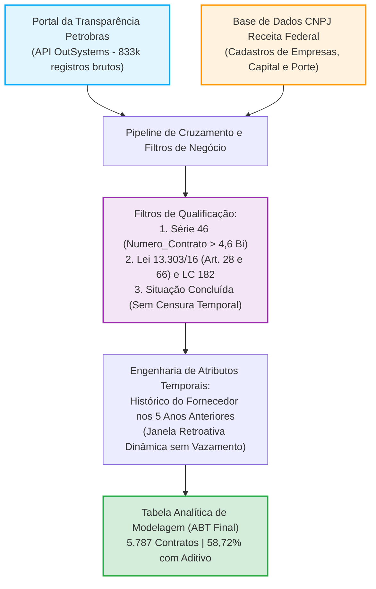

# Relatório Técnico de Engenharia de Dados e Análise Exploratória (EDA): Base Analítica de Contratos da Petrobras (ABT)

---

## 1. Sumário Executivo e Visão Geral

Este documento apresenta o relatório metodológico formal de **Engenharia de Dados** e **Análise Exploratória de Dados (EDA - *Exploratory Data Analysis*)** da Tabela Analítica de Modelagem (**ABT — *Analytical Base Table***), estruturada para subsidiar o pipeline de Machine Learning (Agrupamento não supervisionado e Classificação supervisionada de termos aditivos).

A base foi construída a partir do cruzamento dos dados abertos de contratações do **Portal da Transparência da Petrobras** com a base pública de cadastros empresariais da **Receita Federal do Brasil (RFB)**.

### Métricas Globais da Base Analítica (ABT)
* **Total de Contratos Elegíveis e Auditados ($N$):** **5.787 contratos** únicos da Série 46.
* **Volume Financeiro Global Pactuado:** **R$ 151,77 Bilhões** (Média: R$ 26,22 Mi | Mediana: R$ 3,44 Mi).
* **Horizonte Médio de Duração Planejada:** **1.076 dias** (~2,95 anos | Mediana: 1.094 dias / 3 anos).
* **Taxa Global de Aditamentos Observada (`fl_aditivo = 1`):** **58,72%** (3.398 contratos aditivados vs. 2.389 não aditivados).
* **Integridade Cadastral:** 0% de valores ausentes (*missings*) nos atributos analíticos finais após padronização e imputação lógica.

---

## 2. Origem dos Dados e Processo de Geração da Base Analítica (ABT)

### 2.1. Fontes Primárias de Informação
1. **Contratos e Termos Aditivos da Petrobras:**
   - Extraídos via requisições estruturadas ao serviço corporativo da Petrobras (`transparencia.petrobras.com.br`).
   - Contém o histórico completo dos contratos vigentes e encerrados, datas de celebração, vigência inicial planejada, valor contratado original em moeda corrente, fundamento legal da contratação e eventos aditivos com impactos em prazo e/ou valor.
2. **Dados Cadastrais da Receita Federal do Brasil:**
   - Tabela pública de estabelecimentos e empresas (arquivos `Empresas` e `Estabelecimentos`).
   - Fornece variáveis cadastrais independentes: Razão Social oficial, Código e Descrição de Porte Empresarial (Microempresa, EPP, Demais), Capital Social Registrado e Natureza Jurídica.

### 2.2. Critérios de Elegibilidade e Regras de Negócio (Filtros de Seleção)
Para garantir a relevância estatística, a comparabilidade jurídica e a validade causal dos modelos, foram aplicados 4 filtros de inclusão:

| Campo / Dimensão | Regra de Negócio Aplicada | Racional Técnico e Jurídico |
|:---|:---|:---|
| **Série Contratual (`Numero_Contrato`)** | `Numero_Contrato > 4.600.000.000` | Filtra exclusivamente contratações corporativas padrão da Série 46 gerenciadas pelo ERP SAP Corporativo da companhia. |
| **Regime Jurídico (`Fundamento_Legal`)** | • Lei 13.303/16, Art. 28, CAPUT • Lei 13.303/16, Art. 28, Licitação por item • Lei 13.303/16, Art. 66 (Reg. Preços) • LC 182 (Marco Legal Startups - CPSI) | Restringe a amostra ao regime concorrencial das Estatais e inovações públicas, descartando dispensas e inexigibilidades que seguem dinâmicas discricionárias distintas. |
| **Ciclo de Vida (`Situacao`)** | • `Concluído` • `Concluído - rescisão` • `Concluído - distrato` | **Eliminação de Censura Temporal à Direita**: Contratos em andamento não tiveram seu ciclo de aditivos encerrado. Incluir contratos abertos introduziria falsos negativos artificiais. |
| **Ajuste de Vigência Futura** | $Fim\_Vigencia > Data\_Atual$ | Nos raros casos de datas teóricas de vigência planejada posteriores ao encerramento cadastral, o cálculo de dias de vigência observada foi truncado na data de referência da extração. |

### 2.3. Engenharia de Features Temporais sem Vazamento de Dados (*Data Leakage*)
A esteira de pré-processamento calculou dinamicamente o histórico de desempenho prévio do fornecedor em uma janela retrospectiva estrita de **5 anos imediatamente anteriores à data de início do contrato sob análise** (`Inicio_Vigencia`):
- Considerou-se apenas contratos do fornecedor que já estivessem **efetivamente finalizados** antes do início do contrato avaliado.
- Foram computadas as contagens de contratos finalizados (`qtd_cont_5a_forn`), contagens de aditivos por modalidade (`qtd_adit_prazo_5a`, `qtd_adit_pv_5a`, `qtd_adit_val_5a`) e suas respectivas taxas relativas (`tx_adit_*`).
- Criou-se o indicador booleano `fl_sem_historico_5a = 1` para fornecedores sem contratos elegíveis finalizados na janela de 5 anos, resolvendo a questão de indeterminação matemática nas taxas ($0/0$).

---

## 3. Dicionário Completo de Variáveis da ABT

As variáveis foram organizadas em blocos funcionais conforme seu papel nos algoritmos preditivos e descritivos:

| Nome da Variável | Tipo Estatístico | Escala / Unidade | Papel Metodológico | Descrição Semântica / Regra de Cálculo |
|:---|:---:|:---:|:---:|:---|
| **`Numero_Contrato`** | Categórico Nominal | Texto / Numérico | Identificador | Chave primária do contrato no ERP Petrobras (Série 46). |
| **`fl_aditivo`** | **Binário (0/1)** | **Booleano** | **Variável Alvo (Target)** | **1 se o contrato sofreu qualquer termo aditivo; 0 se não teve aditivo.** |
| **`Valor_Original`** | Numérico Contínuo | Reais (R$) | Preditivo (Cluster/Classif) | Valor monetário inicial pactuado na assinatura original. |
| **`duracao_planejada_dias`** | Numérico Discreto | Dias corridos | Preditivo (Cluster/Classif) | Intervalo temporal previsto entre o início e o término da vigência original. |
| **`Capital_Social_Receita`** | Numérico Contínuo | Reais (R$) | Preditivo (Cluster/Classif) | Porte patrimonial registrado da empresa perante a Receita Federal. |
| **`Porte_Empresa`** | Categórico Nominal | 4 categorias | Preditivo (Classificação) | Porte oficial RFB (*Demais*, *EPP*, *Microempresa*, *Não Encontrado/Exterior*). |
| **`qtd_cont_5a_forn`** | Numérico Discreto | Contagem inteira | Preditivo (Cluster/Classif) | Quantidade de contratos finalizados do fornecedor nos 5 anos anteriores. |
| **`fl_sem_historico_5a`** | Binário (0/1) | Booleano | Preditivo (Classificação) | Indicador de ausência de contratos no histórico recente (1 = Sem histórico). |
| **`qtd_adit_prazo_5a`** | Numérico Discreto | Contagem inteira | Preditivo (Classificação) | Quantidade de contratos anteriores com aditivo exclusivo de prazo nos 5 anos. |
| **`tx_adit_prazo_5a`** | Numérico Contínuo | Proporção $[0, 1]$ | Preditivo (Classificação) | Taxa de contratos anteriores com aditivo de prazo ($\frac{\text{qtd\_adit\_prazo\_5a}}{\text{qtd\_cont\_5a\_forn}}$). |
| **`qtd_adit_pv_5a`** | Numérico Discreto | Contagem inteira | Preditivo (Classificação) | Quantidade de contratos anteriores com aditivos simultâneos de prazo e valor. |
| **`tx_adit_pv_5a`** | Numérico Contínuo | Proporção $[0, 1]$ | Preditivo (Classificação) | Taxa de contratos anteriores com aditivos simultâneos de prazo e valor. |
| **`qtd_adit_val_5a`** | Numérico Discreto | Contagem inteira | Preditivo (Classificação) | Quantidade de contratos anteriores com aditivo exclusivo de valor nos 5 anos. |
| **`tx_adit_val_5a`** | Numérico Contínuo | Proporção $[0, 1]$ | Preditivo (Classificação) | Taxa de contratos anteriores com aditivo exclusivo de valor nos 5 anos. |
| **`tx_adit_geral_5a`** | Numérico Contínuo | Proporção $[0, 1]$ | Preditivo (Classificação) | Taxa global histórica de contratos aditivados do fornecedor nos 5 anos. |
| **`tipo_ult_adit`** | Categórico Nominal | 4 categorias | Preditivo (Classificação) | Modalidade do último aditivo anterior (*Prazo_e_Valor*, *Nenhum*, *Valor*, *Prazo*). |
| **`tipo_fundamento_licitacao`** | Categórico Nominal | 4 categorias | Contextual / Controle | Submodalidade licitatória (*Licitacao_Geral_Art28*, *Item*, *Registro_Precos*, *CPSI*). |

---

## 4. Sanidade dos Dados: Diagnóstico de Missing e Outliers

### 4.1. Auditoria de Valores Ausentes (*Missing Values*)
1. **Campos da Transparência:** Todas as variáveis nativas contratuais (`Numero_Contrato`, `Valor_Original`, `duracao_planejada_dias`, `fl_aditivo`) apresentaram **100% de completude**.
2. **Campos Cadastrais da Receita Federal:** Identificou-se que a coluna `Ente_Federativo_Responsavel` continha 100% de missings por tratar-se de atributo exclusivo de autarquias estatais, tendo sido integralmente excluída do estudo.
3. **Fornecedores Internacionais / Sem CNPJ:** 114 contratos (1,97% da base) pertencem a empresas estrangeiras sem CNPJ registrado na base brasileira da Receita Federal. Tais registros foram consolidados na categoria explícita `'Não Encontrado / Exterior'`, evitando descarte de dados e preservando a integridade da amostra.

### 4.2. Diagnóstico Formal de Outliers pelo Método do Intervalo Interquartil (IQR)
A regra clássica de Tukey ($IQR = Q_3 - Q_1$) estabelece que observações superiores a $Q_3 + 1,5 \times IQR$ ou inferiores a $\max(0, Q_1 - 1,5 \times IQR)$ são classificadas como valores atípicos (*outliers*):

| Variável Analisada | Primeiro Quartil ($Q_1$) | Mediana ($Q_2$) | Terceiro Quartil ($Q_3$) | Intervalo Interquartil ($IQR$) | Limite Superior ($Q_3 + 1,5 \times IQR$) | Qtd. Outliers Superiores | % da Base Total | Máximo Observado |
|:---|:---:|:---:|:---:|:---:|:---:|:---:|:---:|:---:|
| `Valor_Original` | R$ 712,7 mil | R$ 3,44 mi | R$ 16,75 mi | R$ 16,03 mi | **R$ 40,79 Milhões** | **761** | **13,15%** | R$ 3,35 Bilhões |
| `Capital_Social_Receita` | R$ 500,0 mil | R$ 5,00 mi | R$ 55,69 mi | R$ 55,19 mi | **R$ 138,48 Milhões** | **1.148** | **19,84%** | R$ 65,00 Bilhões |
| `duracao_planejada_dias` | 754 dias | 1.094 dias | 1.334 dias | 580 dias | **2.204 dias (~6 anos)** | **12** | **0,21%** | 2.312 dias |
| `qtd_cont_5a_forn` | 0 | 0 | 0 | 0 | **0** | **948** | **16,38%** | 5.922 contratos |
| `qtd_adit_prazo_5a` | 0 | 0 | 0 | 0 | **0** | **377** | **6,51%** | 69 aditivos |
| `qtd_adit_pv_5a` | 0 | 0 | 0 | 0 | **0** | **315** | **5,44%** | 55 aditivos |
| `qtd_adit_val_5a` | 0 | 0 | 0 | 0 | **0** | **282** | **4,87%** | 33 aditivos |

> [!IMPORTANT]
> **Tratamento e Não Exclusão de Outliers:**
> Os valores extremos identificados em `Valor_Original` e `Capital_Social_Receita` **não decorrem de erro de digitação**, mas sim da natureza legítima da indústria de óleo e gás (onde atuam grandes multinacionais de engenharia e afretamento de plataformas). A remoção mecânica desses registros descaracterizaria a carteira estratégica da organização. Por isso, utilizou-se **escalonamento robusto / MinMax** no clustering e **modelos baseados em árvores de decisão** (que são naturalmente invariantes a transformações monotônicas e imunes a distorções de cauda).

---

## 5. Análise Exploratória Univariada

### 5.1. Distribuição da Variável Resposta (`fl_aditivo`)
A variável dependente binária apresenta leve predominância de contratos aditivados, sem configuração de desbalanceamento severo:

* **Classe 1 (Com Aditivo):** **3.398 contratos (58,72%)**
* **Classe 0 (Sem Aditivo):** **2.389 contratos (41,28%)**
* Essa proporção natural dispensa técnicas artificiais agressivas de sobreamostragem (como SMOTE), permitindo trabalhar com a prevalência real de mercado via ajustes no limiar de decisão (*threshold* de corte).

### 5.2. Distribuição das Variáveis Categóricas
* **Porte da Empresa (`Porte_Empresa`):** Ampla hegemonia da categoria **Demais (Médio e Grande Porte)**, reunindo **4.461 contratos (77,09%)**. As Empresas de Pequeno Porte (EPP) representam **688 contratos (11,89%)**, as Microempresas (ME) somam **524 contratos (9,05%)** e a categoria Não Informado/Exterior responde por **114 contratos (1,97%)**.
* **Tipo do Último Aditivo (`tipo_ult_adit`):** A classe **Nenhum** lidera com **2.550 contratos (44,06%)**, seguida por **Prazo_e_Valor com 2.284 contratos (39,47%)**, **Valor com 577 contratos (9,97%)** e **Prazo exclusivo com 376 contratos (6,50%)**.

### 5.3. Medidas Descritivas Exaustivas das Variáveis Quantitativas
A tabela a seguir consolida as medidas de tendência central, dispersão, separatrizes, assimetria (*skewness*) e o **Coeficiente de Variação ($CV\% = \frac{\sigma}{\mu} \times 100$)** para as 5.787 linhas da base:

| Variável | Média ($\mu$) | Desvio Padrão ($\sigma$) | Coeficiente Variação ($CV\%$) | Mínimo | $Q_1$ (25%) | Mediana ($Q_2$) | $Q_3$ (75%) | $Q_{90}$ | $Q_{95}$ | IQR | Máximo | Assimetria |
|:---|---:|---:|---:|---:|---:|---:|---:|---:|---:|---:|---:|---:|
| `Valor_Original` (R$) | 26.225.491,98 | 101.586.861,87 | **387,36%** | 0,01 | 712.743,14 | **3.441.387,15** | 16.745.151,00 | 53.021.146,45 | 105.103.475,39 | 16.032.407,86 | 3.345.927.317,66 | +14,77 |
| `duracao_planejada_dias` | 1.076,00 | 421,03 | **39,13%** | 0 | 754,00 | **1.094,00** | 1.334,00 | 1.704,80 | 1.824,00 | 580,00 | 2.312 | -0,03 |
| `Capital_Social_Receita` (R$) | 370.000.362,61 | 2.494.064.845,85 | **674,07%** | 0,00 | 500.000,00 | **5.000.000,00** | 55.693.962,00 | 423.343.768,00 | 1.115.078.257,20 | 55.193.962,00 | 65.000.000.000,00 | +16,40 |
| `qtd_cont_5a_forn` | 19,80 | 233,57 | **1.179,46%** | 0 | 0,00 | **0,00** | 0,00 | 3,00 | 10,00 | 0,00 | 5.922 | +17,97 |
| `qtd_adit_prazo_5a` | 0,32 | 2,77 | **869,65%** | 0 | 0,00 | **0,00** | 0,00 | 0,00 | 1,00 | 0,00 | 69 | +15,87 |
| `tx_adit_prazo_5a` | 0,03 | 0,14 | **489,27%** | 0,00 | 0,00 | **0,00** | 0,00 | 0,00 | 0,12 | 0,00 | 1,00 | +5,64 |
| `qtd_adit_pv_5a` | 0,26 | 2,32 | **891,47%** | 0 | 0,00 | **0,00** | 0,00 | 0,00 | 1,00 | 0,00 | 55 | +15,54 |
| `tx_adit_pv_5a` | 0,02 | 0,13 | **535,42%** | 0,00 | 0,00 | **0,00** | 0,00 | 0,02 | 0,02 | 0,00 | 1,00 | +6,27 |
| `qtd_adit_val_5a` | 0,15 | 1,20 | **798,03%** | 0 | 0,00 | **0,00** | 0,00 | 0,00 | 0,00 | 0,00 | 33 | +17,69 |
| `tx_adit_val_5a` | 0,02 | 0,10 | **624,51%** | 0,00 | 0,00 | **0,00** | 0,00 | 0,00 | 0,00 | 0,00 | 1,00 | +7,67 |
| `tx_adit_geral_5a` | 0,03 | 0,16 | **455,08%** | 0,00 | 0,00 | **0,00** | 0,00 | 0,00 | 0,20 | 0,00 | 1,00 | +5,01 |

- **Diagnóstico da Assimetria e Dispersão:**
  - `duracao_planejada_dias` é a única variável com **distribuição praticamente simétrica** (assimetria = -0,03 e $CV = 39,13\%$), com forte concentração em contratos de 3 anos (1.094 dias).
  - `Valor_Original` e `Capital_Social_Receita` exibem **assimetria fortemente positiva (> 14)** e coeficientes de variação elevados ($387\%$ e $674\%$), confirmando que a média é inflada por valores bilionários atípicos. A **mediana** é a métrica primordial para tomada de decisão.
  - As contagens e taxas históricas de aditivos apresentam **inflação de zeros (*zero-inflation*)**: mais de 75% dos fornecedores não possuem contratos com aditivos registrados na janela de 5 anos, concentrando a variabilidade nos percentis $Q_{90}$ e $Q_{95}$.

---

## 6. Análise Exploratória Bivariada e Testes de Hipótese

### 6.1. Boxplots Bivariados das Variáveis Numéricas vs. Target (`fl_aditivo`)
Para investigar formalmente o poder discriminatório de cada preditor contínuo frente à ocorrência de termos aditivos, foram gerados **boxplots bivariados estratificados pela variável resposta**:

### 6.2. Teste Não-Paramétrico de Mann-Whitney U e Comparativo de Quartis
Como as distribuições numéricas violam o pressuposto de normalidade gaussiana, aplicou-se o teste não-paramétrico de postos de **Mann-Whitney U** para avaliar se a distribuição dos contratos aditivados difere significativamente dos não aditivados:

| Variável Numérica | Sem Aditivo ($Q_1$) | Sem Aditivo Mediana ($Q_2$) | Sem Aditivo ($Q_3$) | Sem Aditivo ($Q_{95}$) | Com Aditivo ($Q_1$) | Com Aditivo Mediana ($Q_2$) | Com Aditivo ($Q_3$) | Com Aditivo ($Q_{95}$) | Estatística $U$ | $p$-valor | Hipótese $H_0$ |
|:---|:---:|:---:|:---:|:---:|:---:|:---:|:---:|:---:|:---:|:---:|:---:|
| **`Valor_Original`** | R$ 380,0 mil | **R$ 1,34 Milhão** | R$ 6,55 mi | R$ 47,81 mi | R$ 1,51 mi | **R$ 6,38 Milhões** | R$ 31,34 mi | R$ 106,62 mi | 2.553.077 | **$< 0,0001$** | Rejeitada |
| **`duracao_planejada_dias`** | 557 dias | **1.094 dias** | 1.096 dias | 1.767 dias | 869 dias | **1.124 dias** | 1.459 dias | 2.016 dias | 2.621.690 | **$< 0,0001$** | Rejeitada |
| **`Capital_Social_Receita`** | R$ 300,0 mil | **R$ 3,00 Milhões** | R$ 20,00 mi | R$ 180,0 mi | R$ 1,00 mi | **R$ 7,00 Milhões** | R$ 51,70 mi | R$ 400,0 mi | 3.482.220 | **$< 0,0001$** | Rejeitada |
| **`qtd_cont_5a_forn`** | 0 | **0** | 1 | 18 | 0 | **0** | 2 | 29 | 4.418.759 | **$< 0,0001$** | Rejeitada |
| **`qtd_adit_prazo_5a`** | 0 | **0** | 0 | 1 | 0 | **0** | 0 | 3 | 4.196.604 | **$< 0,0001$** | Rejeitada |
| **`tx_adit_prazo_5a`** | 0,00 | **0,00** | 0,00 | 0,33 | 0,00 | **0,00** | 0,00 | 0,60 | 4.195.409 | **$< 0,0001$** | Rejeitada |
| **`qtd_adit_pv_5a`** | 0 | **0** | 0 | 1 | 0 | **0** | 0 | 3 | 4.191.134 | **$< 0,0001$** | Rejeitada |
| **`tx_adit_pv_5a`** | 0,00 | **0,00** | 0,00 | 0,33 | 0,00 | **0,00** | 0,00 | 0,60 | 4.189.761 | **$< 0,0001$** | Rejeitada |

#### Interpretação dos Achados Bivariados:
1. **Impacto Desproporcional do Valor Original:**
   - A mediana do valor original nos contratos aditivados é de **R$ 6,38 Milhões**, contra apenas **R$ 1,34 Milhão** no grupo sem aditivo (**quase 5 vezes superior**, com $p = 5,83 \times 10^{-128}$).
   - O primeiro quartil ($Q_1$) do grupo com aditivo (R$ 1,51 mi) já supera a mediana inteira do grupo sem aditivo (R$ 1,34 mi). No percentil 95, contratos com aditivo atingem **R$ 106,62 Milhões**.
2. **Tempo de Exposição ao Risco (Duração Planejada):**
   - Contratos que sofrem aditivos possuem horizontes mais dilatados ($p = 8,43 \times 10^{-118}$). O terceiro quartil salta de 1.096 dias para 1.459 dias (~4 anos), e o $Q_{95}$ ultrapassa 2.016 dias (~5,5 anos). A duração opera como catalisador de aditamentos decorrentes de revisões orçamentárias, flutuações de mercado e alterações de cronograma executivo.
3. **Capacidade Financeira da Contratada:**
   - Empresas com contratos aditivados possuem capital social mediano mais que duas vezes maior (**R$ 7,00 Milhões vs. R$ 3,00 Milhões**). Grandes corporações atuam em obras e serviços de maior envergadura, que concentram historicamente maior índice de aditamentos.
4. **Significância em Variáveis com Mediana Zero:**
   - Embora as contagens e taxas históricas de aditivos tenham mediana zero em ambos os grupos devido ao excesso de zeros, o teste de Mann-Whitney U avalia a **distribuição global de postos**. No percentil $Q_{95}$, o grupo aditivado atinge **3 aditivos e 60% de taxa**, enquanto o grupo sem aditivo tem apenas **1 aditivo e 33% de taxa**, confirmando que fornecedores reincidentes geram maior risco de aditamento futuro.

### 6.3. Análise Bivariada Categórica (Tabelas de Contingência e Qui-Quadrado)

| Variável Categórica | Categorias | % Sem Aditivo (0) | % Com Aditivo (1) | Total de Contratos ($N$) | Estatística $\chi^2$ (Graus Liberdade) | $p$-valor | $V$ de Cramér (Intensidade) |
|:---|:---|:---:|:---:|:---:|:---:|:---:|:---:|
| **Porte da Empresa** | Microempresa (ME) | 48,85% | 51,15% | 524 | $\chi^2(3) = 68,62$ | $8,43 \times 10^{-15}$ | **0,109** (Associação Fraca) |
| | Pequeno Porte (EPP) | **53,49%** | 46,51% | 688 | | | |
| | Demais (Médio/Grande) | 38,62% | **61,38%** | 4.461 | | | |
| | Não Encontrado/Exterior | 36,84% | **63,16%** | 114 | | | |
| **Tipo do Último Aditivo** | Nenhum | 43,61% | 56,39% | 2.550 | $\chi^2(3) = 25,25$ | $1,37 \times 10^{-5}$ | **0,066** (Associação Desprezível) |
| | Prazo | 40,16% | 59,84% | 376 | | | |
| | Valor | 46,45% | 53,55% | 577 | | | |
| | Prazo_e_Valor | 37,57% | **62,43%** | 2.284 | | | |

* **Interpretação:**
  * O teste Qui-Quadrado confirma dependência estatisticamente significante ($p < 0,001$) para ambas as variáveis.
  * Empresas de porte **Demais** (médio/grande) e **Estrangeiras** apresentam as maiores taxas de aditamento (**61,38% e 63,16%**), enquanto EPPs registram a menor incidência (**46,51%**).
  * Fornecedores cujo histórico inclui aditivos simultâneos de **Prazo e Valor** apresentam taxa de aditamento de **62,43%**, superior aos fornecedores sem histórico ou com aditivos exclusivos de valor.

---

## 7. Análise Multivariada de Correlação Estratificada

Para examinar a estrutura de dependência interna das features e diagnosticar potenciais redundâncias ou colinearidades, calculou-se a matriz de **Correlação de Postos de Spearman** ($\rho$), estratificada para contratos sem aditivo (Grupo 0) e com aditivo (Grupo 1):

### Principais Constatações de Correlação:
1. **Colinearidade Estrita entre Volumes Contratuais:** A correlação entre o histórico total do fornecedor (`qtd_cont_forn_tot`) e o histórico recente dos 5 anos (`qtd_cont_5a_forn`) atinge $\rho = 0,84$. Para evitar instabilidade por multicolinearidade em modelos lineares e distorções de distância, **reteve-se exclusivamente a variável dos 5 anos (`qtd_cont_5a_forn`)**.
2. **Associação Moderada entre Duração e Valor:** A correlação entre `Valor_Original` e `duracao_planejada_dias` situa-se em $\rho = 0,42$ (Grupo 0) e $\rho = 0,45$ (Grupo 1). Contratos mais longos tendem a ser mais vultosos, porém a magnitude não compromete a independência das variáveis.
3. **Forte Associação entre Tipologias de Aditivos Anteriores:** Os aditivos de prazo (`qtd_adit_prazo_5a`) e simultâneos de prazo/valor (`qtd_adit_pv_5a`) possuem correlação de $\rho \approx 0,70$ entre si, refletindo fornecedores que enfrentam problemas recorrentes de gestão de cronograma.

---

## 8. Síntese dos Insights da EDA e Implicações para a Modelagem

A análise exploratória orientou diretamente todas as decisões tomadas na concepção dos modelos de Machine Learning:

| Achado da Análise Exploratória (EDA) | Decisão Metodológica no Pipeline | Impacto no Desempenho do Modelo |
|:---|:---|:---|
| **Assimetria severa (> 14) em grandezas monetárias e de capital.** | Adoção obrigatória do **MinMaxScaler** no K-Means e modelos baseados em **árvores (Random Forest)** na classificação. | Evitou que valores em Reais dominassem o cálculo de distâncias euclidianas no clustering. |
| **Ausência de correlação linear perfeita entre os preditores.** | Preservação do quarteto `Valor_Original`, `duracao_planejada_dias`, `Capital_Social_Receita` e `qtd_cont_5a_forn` no **Cenário 1**. | Garantiu partições balanceadas, parcimoniosas e interpretáveis no agrupamento de 3 clusters. |
| **Salto abrupto de medianas em contratos aditivados ($5\times$ no valor e $+33\%$ no prazo).** | Seleção das variáveis de vigência e valor como separadores de primeira ordem (*split primário*) nas árvores. | Proporcionou alta discriminação de risco, atingindo **KS = 0,5034** e **ROC-AUC = 0,8172**. |
| **Inflação de zeros nas métricas históricas de aditivo dos fornecedores.** | Criação da flag binária `fl_sem_historico_5a` e imputação lógica das taxas em zero. | Permitiu incorporar o histórico sem descartar empresas novas ou entrantes no cadastro da Petrobras. |
| **Equilíbrio natural da classe alvo (58,7% vs. 41,3%).** | Descarte de métodos sintéticos de balanceamento (SMOTE/undersampling) e calibração fina do limiar de corte ($T = 0,442$). | Maximizou a captura de contratos críticos minimizando falsos alarmes operacionais para a gestão. |

---

## 9. Localização dos Artefatos Gerados

* **Relatório em Markdown no Workspace:** [relatorio_engenharia_e_analise_exploratoria_base.md](file:///c:/Users/User/Documents/GitHub/ronaldo_geizi_ml/specs/relatorio_engenharia_e_analise_exploratoria_base.md)
* **Base Analítica Estruturada (ABT):** [abt_modelagem_aditivos.csv](file:///c:/Users/User/Documents/GitHub/ronaldo_geizi_ml/dados/abt_modelagem_aditivos.csv)
* **Painel de Gráficos de EDA e Diagnósticos:** Pasta `classificacao_graficos/` e `src/cluster_graficos/`.

