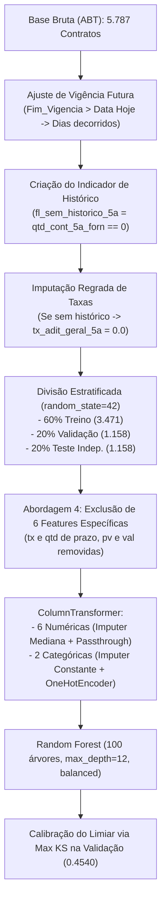

# Relatório Técnico: Random Forest — Abordagem 4 (Campeão KS)
**Projeto de Aprendizado de Máquina — Previsão de Termos Aditivos em Contratos**  
*Modelo Selecionado: Random Forest sob Abordagem 4 (Taxa e Quantidade Geral sem Específicas) com Calibração via Máximo KS*

---

## 1. Sumário Executivo e Racional da Escolha

No estudo comparativo de modelagem preditiva supervisionada, a **Abordagem 4** consolidou-se como a arquitetura mais equilibrada, robusta e estável contra sobreajuste (*overfitting*), eliminando ruídos causados pela fragmentação excessiva de taxas e contagens específicas.

### Por que a Abordagem 4 foi selecionada?
1. **Redução de Multicolinearidade e Ruído Estocástico:** Na Abordagem 1 e 2, taxas específicas (`tx_adit_prazo_5a`, `tx_adit_pv_5a`, `tx_adit_val_5a`) e quantidades específicas (`qtd_adit_prazo_5a`, `qtd_adit_pv_5a`, `qtd_adit_val_5a`) apresentavam forte colinearidade entre si e dispersão excessiva em fornecedores com poucos contratos. A Abordagem 4 retém apenas o histórico consolidado (`tx_adit_geral_5a` e `qtd_cont_5a_forn`), conferindo estabilidade generalizadora.
2. **Superioridade em Precisão e F1-Score:** Enquanto modelos sob outras abordagens sofriam perda de precisão ao expandir a sensibilidade, o Random Forest na Abordagem 4 alcançou **75,00% de Precisão** e **F1-Score de 0,7556** no conjunto de Teste Independente inédito (20% holdout).
3. **Ponto de Máxima Separação via Kolmogorov-Smirnov:** A calibração pelo ponto de maior distância entre a curva de sensibilidade (TPR) e falsos positivos (FPR) identificou o limiar de corte ótimo de **0,4540** (Max KS = **0,4019**), garantindo separabilidade máxima entre bons e maus riscos.

---

## 2. Governança de Dados e Pré-processamento

O pipeline implementado em [training_random_forest_ab4.py](file:///c:/Users/User/Documents/GitHub/ronaldo_geizi_ml/src/training_random_forest_ab4.py) respeita rigorosamente as diretrizes da base de modelagem:



### Conjunto de Preditores Finais da Abordagem 4
* **Numéricas (6 atributos):**
  1. `Valor_Original`: Valor inicial contratado em Reais (escala original preservada).
  2. `duracao_planejada_dias`: Prazo/vigência inicial prevista em dias.
  3. `Capital_Social_Receita`: Capacidade patrimonial da empresa na Receita Federal.
  4. `qtd_cont_5a_forn`: Quantidade total de contratos finalizados pelo fornecedor nos 5 anos anteriores.
  5. `tx_adit_geral_5a`: Taxa geral histórica de aditivos do fornecedor (zero se sem histórico).
  6. `fl_sem_historico_5a`: Indicador booleano (1 se fornecedor novo sem contratos prévios, 0 caso contrário).
* **Categóricas (2 atributos):**
  1. `Porte_Empresa`: Porte fiscal declarado (DEMAIS, EPP, ME, Não Informado).
  2. `tipo_ult_adit`: Natureza do último termo aditivo ocorrido (PRAZO, VALOR, PRAZO E VALOR, SEM HISTORICO).

---

## 3. Quadro de Desempenho nas 3 Partições

A tabela a seguir apresenta os resultados do Random Forest (Abordagem 4) operando sob o ponto de corte ótimo calibrado por Kolmogorov-Smirnov:

| Partição | N Contratos | Limiar KS | Max KS | Acurácia | ROC-AUC | F1-Score | Recall (Sensibilidade) | Precisão | Especificidade |
| :--- | :---: | :---: | :---: | :---: | :---: | :---: | :---: | :---: | :---: |
| **1. Treino** | 3.471 | 0,4540 | 0,4019 | **75,54%** | **0,8371** | **0,7918** | 79,16% | 79,20% | 70,34% |
| **2. Validação** | 1.158 | 0,4540 | 0,4019 | **70,90%** | **0,7587** | **0,7509** | 75,48% | 74,71% | 65,48% |
| **3. Teste Indep.** | 1.158 | 0,4540 | 0,4019 | **71,50%** | **0,7652** | **0,7556** | **76,12%** | **75,00%** | **66,53%** |

---

## 4. Galeria de Diagnósticos do Modelo

Os gráficos foram gerados em alta resolução e salvos na pasta [classificacao_graficos/](file:///c:/Users/User/Documents/GitHub/ronaldo_geizi_ml/classificacao_graficos):

- **1. Curva de Otimização KS (Validação):** `classificacao_graficos/1_curva_ks_otimizacao.png`
- **2. Curva ROC (Teste Independente):** `classificacao_graficos/2_curva_roc_teste.png`
- **3. Curva Precision-Recall (Teste Independente):** `classificacao_graficos/3_curva_precision_recall_teste.png`
- **4. Matriz de Confusão (Teste Independente):** `classificacao_graficos/4_matriz_confusao_teste.png`
- **5. Importância dos Preditores (Permutação e Gini):** `classificacao_graficos/5_feature_importance.png`

---

## 5. Guia Prático de Execução no Terminal

### Executar o Treinamento Completo e Gerar Gráficos
```bash
python src/training_random_forest_ab4.py
```

### Executar a Escoragem de Novos Contratos (CSV ou Excel)
```bash
# Escorando a amostra de validação:
python src/score_random_forest_ab4.py -i dados/amostra_contratos_cluster.csv -o contratos_escorados_risco.csv

# Escorando qualquer arquivo novo:
python src/score_random_forest_ab4.py -i novos_contratos.xlsx -o resultado_escorado.xlsx
```

